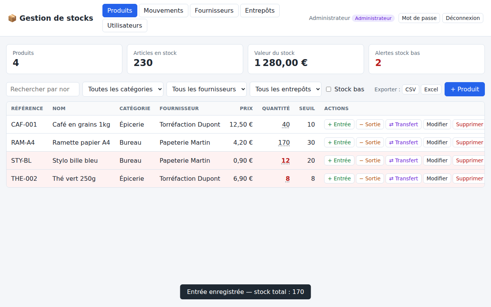
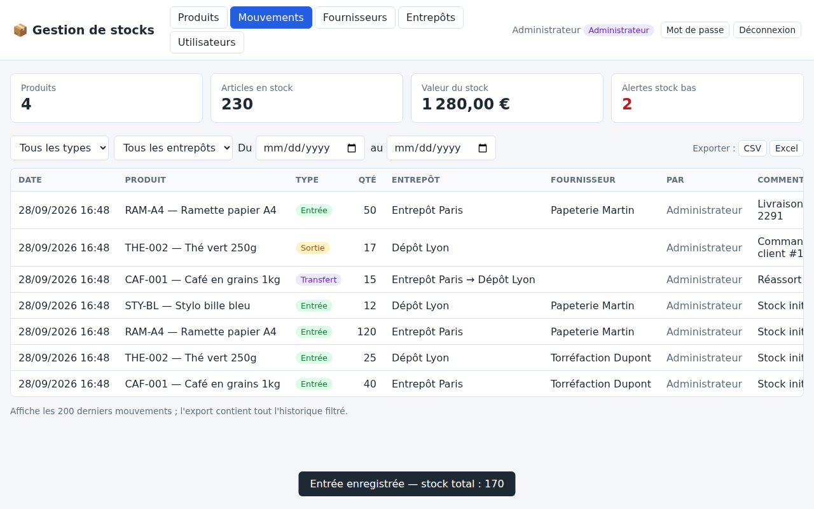
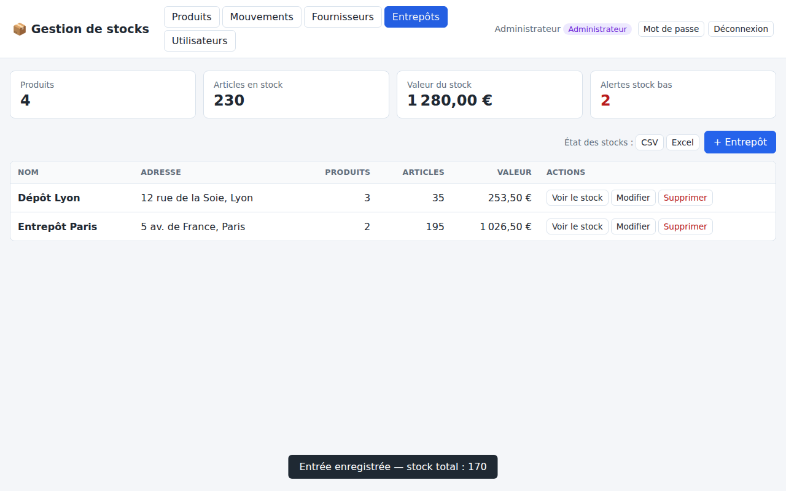
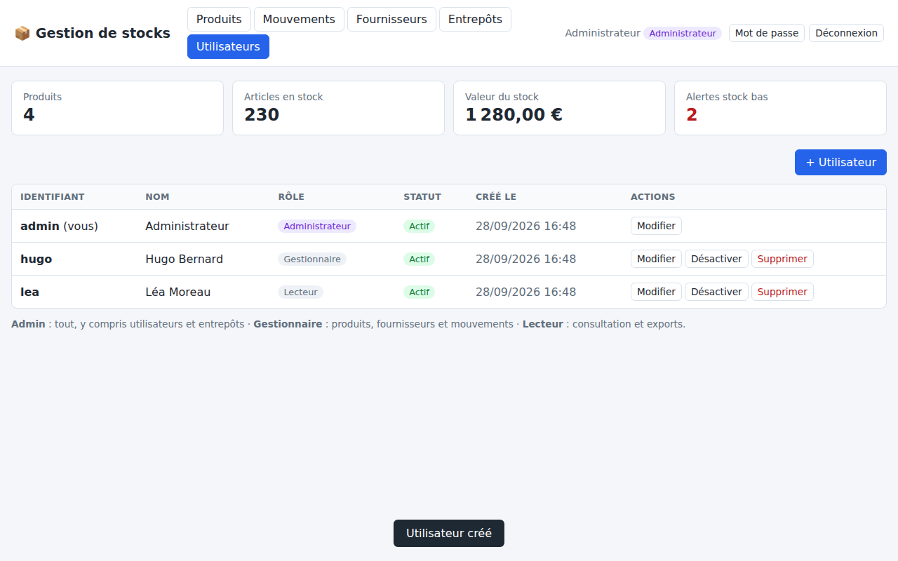
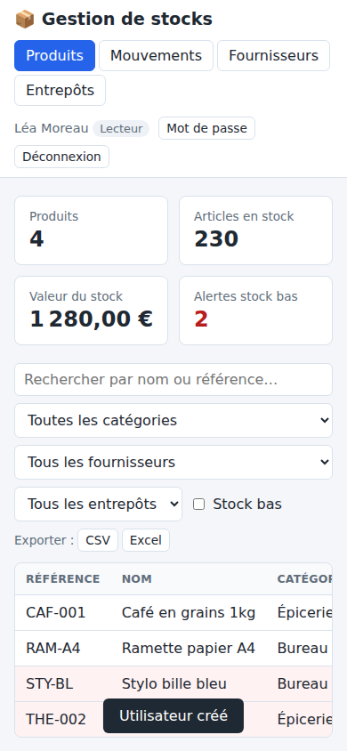

# Gestion de stocks

Application web de gestion de stocks multi-entrepôts, avec fournisseurs, comptes utilisateurs et exports CSV/Excel.



## Fonctionnalités

- **Produits** : référence unique, nom, catégorie, fournisseur, prix, seuil d'alerte ; recherche et filtres (catégorie, fournisseur, entrepôt, stock bas)
- **Multi-entrepôts** : stock suivi par entrepôt, **transferts** entre entrepôts, filtre par entrepôt (statistiques comprises), détail de la répartition au survol de la quantité
- **Mouvements** : entrées (avec fournisseur), sorties et transferts, avec commentaire et auteur. Une sortie ne peut pas dépasser le stock de l'entrepôt concerné. La quantité ne se modifie que par des mouvements, ce qui garantit un historique complet.
- **Fournisseurs** : coordonnées, notes, nombre de produits liés
- **Utilisateurs et rôles** :
  | Rôle | Droits |
  |---|---|
  | Administrateur | tout, y compris les utilisateurs et les entrepôts |
  | Gestionnaire | produits, fournisseurs et mouvements |
  | Lecteur | consultation et exports uniquement |
- **Exports CSV et Excel (.xlsx)** : produits (avec une colonne de stock par entrepôt), mouvements (historique complet filtré), fournisseurs, état des stocks par entrepôt. Les exports respectent les filtres affichés.
- **Tableau de bord** : nombre de produits, articles en stock, valeur du stock, alertes de stock bas

## Démarrage

Prérequis : Node.js 22.13 ou plus récent (utilise le module SQLite intégré `node:sqlite`).

```bash
npm install
npm start
```

Puis ouvrir <http://localhost:3000>.

**Premier démarrage** : un compte `admin` est créé automatiquement et son **mot de passe provisoire s'affiche dans la console**. Changez-le après la première connexion (bouton « Mot de passe »). Pour choisir ce mot de passe vous-même :

```bash
ADMIN_PASSWORD='mon-mot-de-passe' npm start
```

### Configuration

| Variable | Rôle | Défaut |
|---|---|---|
| `PORT` | Port HTTP | `3000` |
| `DB_FILE` | Fichier de la base SQLite | `stock.db` |
| `ADMIN_PASSWORD` | Mot de passe du compte `admin` créé au premier démarrage | aléatoire, affiché dans la console |
| `COOKIE_SECURE` | Mettre `1` en production derrière HTTPS | — |
| `TZ` | Fuseau horaire utilisé pour les dates des exports | celui du serveur |

## Sécurité

- Mots de passe hachés avec **scrypt** (sel aléatoire), jamais renvoyés par l'API
- Sessions par cookie `HttpOnly` et `SameSite=Strict` (protection CSRF), stockées sous forme d'empreinte SHA-256, valables 7 jours
- Limitation des tentatives de connexion (10 échecs par identifiant sur 15 minutes)
- Changer son mot de passe déconnecte les autres appareils ; désactiver un compte coupe ses sessions
- Exports CSV protégés contre l'injection de formules

## Tests

```bash
npm test
```

22 tests couvrent l'authentification, les rôles, les stocks multi-entrepôts, les règles de suppression, la validation et les exports.

## API REST

Toutes les routes (sauf la connexion) exigent une session.

| Méthode | Route | Description |
|---|---|---|
| POST | `/api/auth/connexion` | `{identifiant, mot_de_passe}` |
| POST | `/api/auth/deconnexion` | Fermer la session |
| GET | `/api/auth/moi` | Utilisateur connecté |
| POST | `/api/auth/mot-de-passe` | `{ancien, nouveau}` |
| GET | `/api/produits?q=&categorie=&fournisseur_id=&entrepot_id=&alerte=1` | Liste des produits, avec `quantite_totale` et le détail `stocks` par entrepôt |
| GET/PUT/DELETE | `/api/produits/:id` | Détail / modification (hors quantité) / suppression |
| POST | `/api/produits` | Création ; `quantite` et `entrepot_id` facultatifs pour le stock initial |
| GET | `/api/mouvements?produit_id=&entrepot_id=&type=&du=AAAA-MM-JJ&au=AAAA-MM-JJ&limite=` | Historique |
| POST | `/api/mouvements` | `{produit_id, type: "entree"\|"sortie"\|"transfert", quantite, entrepot_id, entrepot_dest_id?, fournisseur_id?, commentaire?}` |
| GET/POST | `/api/fournisseurs` | Liste (`?q=`) / création |
| GET/PUT/DELETE | `/api/fournisseurs/:id` | Les produits d'un fournisseur supprimé sont conservés |
| GET/POST | `/api/entrepots` | Liste avec totaux / création (admin) |
| PUT/DELETE | `/api/entrepots/:id` | Admin ; suppression possible seulement si vide et sans historique |
| GET/POST | `/api/utilisateurs` | Admin |
| PUT/DELETE | `/api/utilisateurs/:id` | Admin ; `{nom, role, actif, mot_de_passe}` |
| GET | `/api/stats?entrepot_id=` | Statistiques |
| GET | `/api/export/{produits\|mouvements\|fournisseurs\|stocks}?format=csv\|xlsx` | Export (accepte les mêmes filtres que les listes) |

## Structure

```
src/
  server.js        point d'entrée
  app.js           assemblage Express, gestion des erreurs
  db.js            schéma SQLite
  auth.js          mots de passe, sessions, rôles
  stock.js         application des mouvements (entrée / sortie / transfert)
  util.js          validation, transactions
  routes/          produits, mouvements, fournisseurs, entrepots, utilisateurs, stats, export
public/            interface web (HTML/CSS/JS sans framework)
test/              tests de l'API (node:test)
docs/              captures d'écran
```

## Captures

| Mouvements | Entrepôts |
|---|---|
|  |  |
| **Utilisateurs** | **Mobile** |
|  |  |
